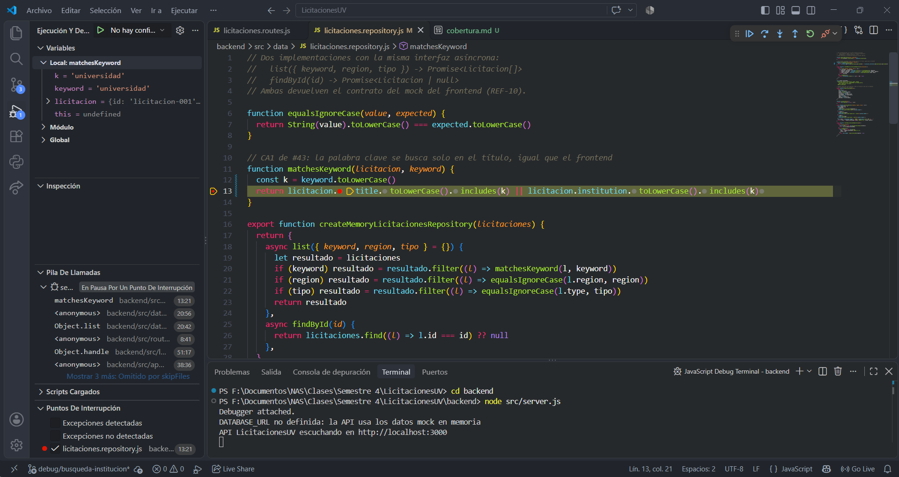
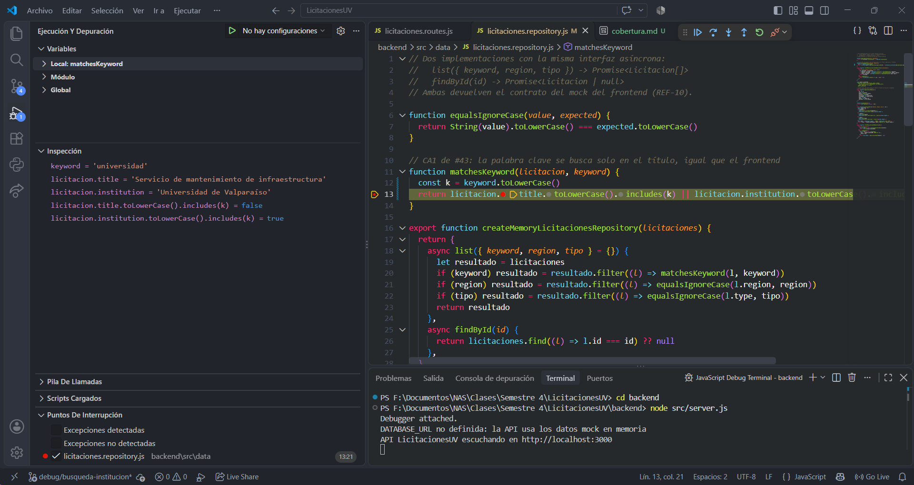
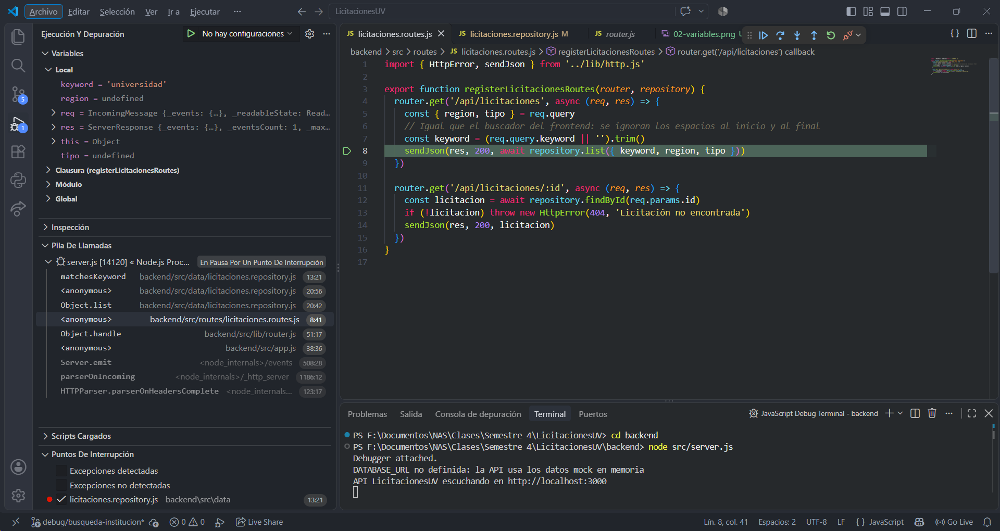
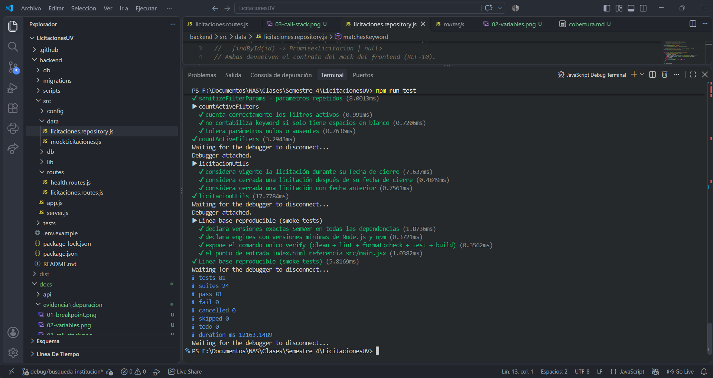

# Depuración sistemática · Búsqueda por palabra clave

> **Historia:** #43 · **Correcciones originales:** PR #71 (frontend) y PR #88 (API) · **Fecha:** 27-10-2026

Registro de la depuración de un defecto real del proyecto, siguiendo el método **reproducir → aislar → hipótesis → corregir → verificar**.

## 1. El defecto

- **Historia afectada:** #43 Buscar licitaciones por palabra clave. Su CA1 exige buscar **solo en el título**.
- **Síntoma:** al buscar una palabra que aparece en la institución pero no en el título, la licitación aparecía igual en los resultados.
- **Dónde estuvo:** primero en el frontend (corregido en el commit `9b41879`, PR #71) y luego en la API (corregido en el commit `01e02d0`, PR #88, detectado en la revisión).
- **Para esta evidencia** se reintrodujo el defecto en una rama local temporal (`debug/busqueda-institucion`, nunca integrada) y se depuró con las herramientas de VS Code.

## 2. Reproducir

**Datos:** catálogo de ejemplo (`src/features/licitaciones/data/licitaciones.mock.json`). La palabra `universidad` solo aparece en la institución de `licitacion-001` ("Universidad de Valparaíso"); ningún título la contiene.

**Pasos:**

1. `cd backend` y `npm start` (sin `DATABASE_URL`, la API usa el catálogo de ejemplo).
2. Abrir `http://localhost:3000/api/licitaciones?keyword=universidad`.

|                                | Resultado                                                                                                                                |
| ------------------------------ | ---------------------------------------------------------------------------------------------------------------------------------------- |
| **Esperado** (CA1 de #43)      | `[]`, ninguna licitación                                                                                                                 |
| **Observado** (con el defecto) | `[{ "id": "licitacion-001", "title": "Servicio de mantenimiento de infraestructura", "institution": "Universidad de Valparaíso", ... }]` |

La suite automática también lo detecta. `npm run test` falla en:

```
not ok 4 - busca la palabra clave solo en el título, no en la institución
  location: 'backend/tests/licitaciones.test.js:53:3'
  error: Expected values to be strictly deep-equal
```

y en el frontend:

```
not ok 1 - busca la palabra clave únicamente en el título
  location: 'tests/licitacionFilters.test.js:29:3'
  error: Expected values to be strictly deep-equal:
    [ '1', + '2' ]
  stack: TestContext.<anonymous> (tests/licitacionFilters.test.js:36:12)
```

**Lectura de la traza:** el tipo de error es `AssertionError` con operador `deepStrictEqual`, así que la función devolvió un resultado distinto al esperado (no se cayó). El primer marco de nuestro código es `licitacionFilters.test.js:36`, el `assert.deepEqual` de la prueba. El valor `+ '2'` indica que apareció un registro de más: el que tiene "transporte" en la institución y no en el título.

## 3. Aislar

La respuesta pasa por tres puntos. Se revisó cada uno para descartar dónde **no** está el problema:

| Paso    | Archivo                                                            | Qué se comprobó                                               |
| ------- | ------------------------------------------------------------------ | ------------------------------------------------------------- |
| Entrada | `backend/src/routes/licitaciones.routes.js:7`                      | `keyword` llega como `'universidad'` (con `trim`): correcto   |
| Filtro  | `backend/src/data/licitaciones.repository.js` → `list()`           | Llama a `matchesKeyword` por cada licitación                  |
| Regla   | `backend/src/data/licitaciones.repository.js` → `matchesKeyword()` | Devuelve `true` para `licitacion-001`: **aquí está el error** |

Caso mínimo: `matchesKeyword({ title: 'Servicio de mantenimiento de infraestructura', institution: 'Universidad de Valparaíso' }, 'universidad')` debería devolver `false` y devuelve `true`.

## 4. Hipótesis

> _La condición de `matchesKeyword` compara la palabra clave también con `institution`, no solo con `title`._

**Cómo comprobarla:** poner un breakpoint en `matchesKeyword` y evaluar por separado las dos partes de la condición. Si la del título da `false` y la de la institución da `true`, la hipótesis se confirma.

## 5. Evidencia con el depurador

Sesión en VS Code con _JavaScript Debug Terminal_, servidor iniciado con `node src/server.js` y la petición del paso 2.

1. **Breakpoint** en la línea de `return` de `matchesKeyword`.
   
2. **Inspección de variables** cuando `licitacion.id` es `licitacion-001`:

   | Expresión (panel Watch)                            | Valor                                            |
   | -------------------------------------------------- | ------------------------------------------------ |
   | `keyword`                                          | `'universidad'`                                  |
   | `licitacion.title`                                 | `'Servicio de mantenimiento de infraestructura'` |
   | `licitacion.institution`                           | `'Universidad de Valparaíso'`                    |
   | `licitacion.title.toLowerCase().includes(k)`       | `false`                                          |
   | `licitacion.institution.toLowerCase().includes(k)` | `true`                                           |

   

3. **Pila de llamadas** (_Call Stack_): `matchesKeyword` ← `filter` ← `list` ← manejador de `GET /api/licitaciones` en `licitaciones.routes.js:8`. Con _Step Out_ se vuelve a `list()` y se ve que `resultado` queda con 1 elemento.
   

**Conclusión:** la parte del título es `false` y la de la institución es `true`. Como están unidas con `||`, la función devuelve `true`. La hipótesis queda confirmada.

## 6. Corregir

La causa es el `||` con `institution`. Se deja solo la comparación con el título:

```js
// Antes (defecto)
return (
  licitacion.title.toLowerCase().includes(k) || licitacion.institution.toLowerCase().includes(k)
)

// Después (corrección, igual que commit 01e02d0)
return licitacion.title.toLowerCase().includes(keyword.toLowerCase())
```

## 7. Verificar

| Comprobación                                                                | Resultado               |
| --------------------------------------------------------------------------- | ----------------------- |
| `?keyword=universidad` (el caso reportado)                                  | `[]`                    |
| `?keyword=mantenimiento` (palabra que sí está en un título)                 | `licitacion-001`        |
| `?keyword=UNIVERSIDAD` y `?keyword=  universidad  ` (mayúsculas y espacios) | `[]`                    |
| `npm run test`                                                              | Todas las pruebas pasan |



**Regresión:** el caso queda protegido por dos pruebas que fallan si el defecto vuelve:

- `busca la palabra clave únicamente en el título` (`tests/licitacionFilters.test.js`)
- `busca la palabra clave solo en el título, no en la institución` (`backend/tests/licitaciones.test.js`)

## 8. Registros

Al iniciar, el servidor deja registros que ayudan a interpretar su estado:

```
DATABASE_URL no definida: la API usa los datos mock en memoria   ← advertencia (warn)
API LicitacionesUV escuchando en http://localhost:3000            ← evento normal (info)
```

El primero confirma que la prueba se hizo con el catálogo de ejemplo y no con PostgreSQL, un dato necesario para reproducir el caso con los mismos datos. Los errores 5xx se registran con `console.error` en `backend/src/app.js` sin mostrar el detalle al cliente.
