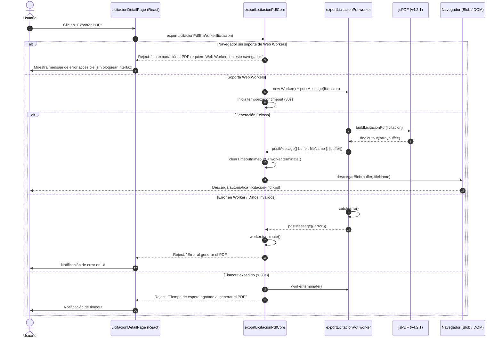

# ISF224 — Verificación del Flujo de Exportación y Auditoría de jsPDF

**Issue:** #135  
**Responsable:** Mauricio Henríquez (@StelleC) — QA Engineer / DevOps  
**Rama:** `chore/135-verificar-flujo-exportacion-jspdf`  
**Versión base evaluada:** `develop @ 9118d18`  
**Dependencia auditada:** `jspdf@4.2.1` (SemVer fija en `package.json`)

---

## 1. Diagrama de Secuencia e Intercambios

La exportación delega la generación del archivo PDF a un **Web Worker** dedicado (`exportLicitacionPdf.worker.js`). De esta manera, el hilo principal de la interfaz React nunca se bloquea ni degrada la experiencia de usuario (CA6), gestionando timeouts (30s) y errores de forma desacoplada:



---

## 2. Escenarios Verificados y Trazabilidad

| Escenario                                | Condición / Entrada                     | Comportamiento Esperado                                                                           | Resultado Obtenido                      | Estado  |
| ---------------------------------------- | --------------------------------------- | ------------------------------------------------------------------------------------------------- | --------------------------------------- | ------- |
| **1. Descarga válida**                   | `licitacionBase` (`licitacion-001`)     | Genera ArrayBuffer con cabecera `%PDF-`, nombre `licitacion-001.pdf` y formato en español chileno | Archivo íntegro generado y descargado   | ✅ PASS |
| **2. Falla en Worker / Datos corruptos** | Error interno simulado en worker        | La promesa rechaza con `"Error al generar el PDF"`, finaliza el worker y no afecta React          | Error controlado sin fugas ni cuelgues  | ✅ PASS |
| **3. Ausencia de Web Workers**           | Entorno donde `Worker` arroja excepción | Rechaza con mensaje explícito descriptivo sin intentar generación síncrona                        | Error visible oportuno sin congelar UI  | ✅ PASS |
| **4. Separación Región / Bases (#126)**  | Licitación con URL de bases largas      | Ambas filas se renderizan en coordenadas verticales distintas                                     | Coordenadas validadas sin superposición | ✅ PASS |

---

## 3. Auditoría de la Dependencia Externa: `jsPDF`

### Ficha Técnica

- **Paquete:** `jspdf`
- **Versión declarada:** `4.2.1` (exacta, sin rangos abiertos `^` ni `~` para reproducibilidad de builds).
- **Licencia:** `MIT`
- **Obligación legal aplicable:** Inclusión del aviso de copyright y exención de responsabilidad en el software compilado (preservado por Vite en los encabezados de los chunks empaquetados).
- **Repositorio oficial y mantenimiento:** `https://github.com/parallax/jsPDF` (organización Parallax, mantenimiento comunitario continuo).

### Matriz de Evaluación de Riesgos

| Riesgo Identificado                           | Prob. | Impacto | Nivel     | Mitigación Implementada                                         | Método de Comprobación                                   |
| --------------------------------------------- | ----- | ------- | --------- | --------------------------------------------------------------- | -------------------------------------------------------- |
| **Bloqueo del Event Loop por PDFs complejos** | Media | Alto    | **Medio** | Generación 100% aislada en Web Worker secundario.               | Prueba unitaria de delegación en worker.                 |
| **Fallo en navegadores antiguos sin Workers** | Baja  | Medio   | **Bajo**  | Detección previa y rechazo controlado con notificación (CA5).   | Prueba unitaria de rechazo sin Web Worker.               |
| **Fugas de memoria por retención de Blobs**   | Baja  | Medio   | **Bajo**  | `URL.revokeObjectURL(url)` inmediato tras el clic de descarga.  | Función `descargarBlob` en `exportLicitacionPdfCore.js`. |
| **Regresiones por dependencias flotantes**    | Baja  | Alto    | **Bajo**  | Fijación SemVer exacta en `package.json` y `package-lock.json`. | Smoke tests de línea base reproducible.                  |

---

## 4. Ejemplo Mínimo Ejecutable (Standalone)

Script reproducible probado en Node.js `>=20.19.0`:

```javascript
import { jsPDF } from 'jspdf'

const doc = new jsPDF()
doc.setFont('helvetica', 'bold')
doc.text('LicitacionesUV - Verificación jsPDF', 10, 10)

const buffer = doc.output('arraybuffer')
const header = Buffer.from(buffer.slice(0, 5)).toString()

console.log('PDF generado exitosamente.')
console.log('Tamaño:', buffer.byteLength, 'bytes')
console.log('Cabecera:', header) // Salida esperada: %PDF-
```

---

## 5. Resultados de la Verificación Automatizada

- **Suite específica (`tests/exportLicitacionPdf.test.js`):** 10/10 pruebas aprobadas (100%).
- **Cobertura de servicios de exportación (`src/features/licitaciones/services/`):**
  - Líneas: **95.94 %**
  - Funciones: **90.00 %**
  - Ramas: **80.00 %**
  - `buildLicitacionPdf.js` y `licitacionPdfFilename.js`: **100 %** en todas las métricas.
- **Pipeline completo (`npm run verify`):**
  - `clean` ✅
  - `lint` (ESLint) ✅
  - `format:check` (Prettier) ✅
  - `test` (122 pruebas totales) ✅
  - `build` (Vite production bundle) ✅
