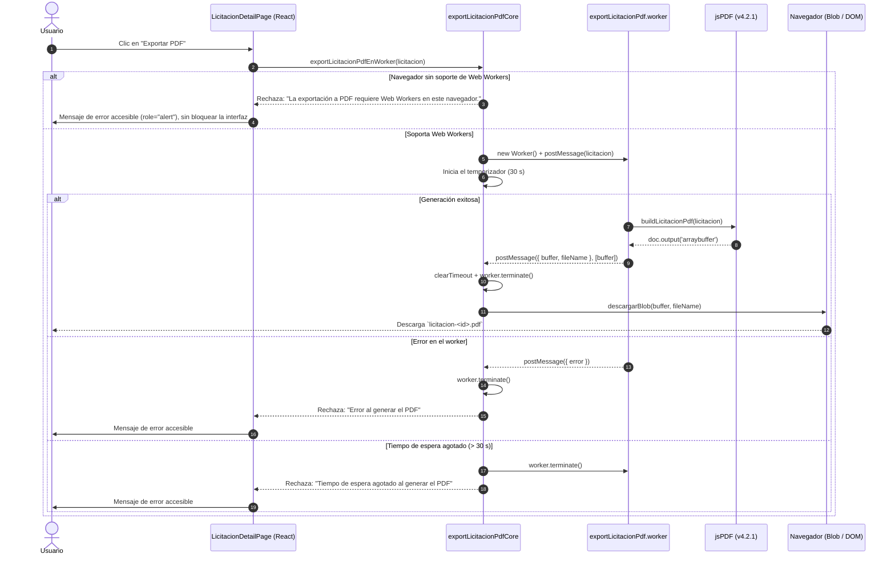

# ISF224 — Verificación del flujo de exportación y revisión de jsPDF

**Issue:** #135  
**Responsable:** Mauricio Henríquez (@StelleC) — QA / DevOps  
**Rama:** `chore/135-verificar-flujo-exportacion-jspdf`  
**Versión evaluada:** `develop @ 1e8b921` (24-11-2026)  
**Dependencia revisada:** `jspdf@4.2.1` (versión exacta en `package.json`)

---

## 1. Diagrama de secuencia e intercambios

La exportación delega la generación del PDF a un **Web Worker** (`exportLicitacionPdf.worker.js`), de modo que el hilo principal de React no se bloquea (CA6). El núcleo (`exportLicitacionPdfCore.js`) maneja el tiempo de espera (30 s) y los errores.



Los datos que viajan al worker son los de la licitación que entrega la API (`GET /api/licitaciones/:id`): id, título, organismo, monto, moneda, fecha de cierre, tipo, región y URL de las bases. El worker devuelve un `ArrayBuffer` transferible o un mensaje de error.

---

## 2. Escenarios verificados

| #   | Escenario                        | Entrada / condición                                                    | Resultado esperado                                                                        | Resultado obtenido                                                                                                                   | Evidencia                                                                                        | Estado |
| --- | -------------------------------- | ---------------------------------------------------------------------- | ----------------------------------------------------------------------------------------- | ------------------------------------------------------------------------------------------------------------------------------------ | ------------------------------------------------------------------------------------------------ | :----: |
| 1   | Descarga válida                  | `licitacion-004` desde el detalle, exportada con teclado (Tab + Enter) | PDF `licitacion-004.pdf`, cabecera `%PDF-`, una página, datos en español                  | 5.191 bytes, `%PDF-1.3`, 1 página, productor jsPDF 4.2.1; región y bases en filas separadas (y = 493 pt y 476 pt)                    | [QA #128 · PDF-01 a PDF-03](../qa-regresion-128/README.md), `tests/exportLicitacionPdf.test.js`  |   ✅   |
| 2   | ID inválido                      | `GET /api/licitaciones/no-existe`                                      | La API responde 404 y el cliente lo trata como «no encontrada»; no se ofrece exportar     | API: 404 `{"error":"Licitación no encontrada"}`. Cliente: `fetchLicitacion` devuelve `null` ante 404                                 | QA backend #9 (DET-02), `tests/licitacionesApi.test.js` («devuelve null si la API responde 404») |   ✅   |
| 3   | Recurso ausente: sin Web Workers | `crearWorker` lanza una excepción                                      | Rechaza con «La exportación a PDF requiere Web Workers…» sin generar en el hilo principal | Rechazo con el mensaje esperado                                                                                                      | `tests/exportLicitacionPdf.test.js` («rechaza sin bloquear si no hay Web Workers disponibles»)   |   ✅   |
| 4   | Falla del worker                 | El worker responde `{ error }`                                         | Rechaza con «Error al generar el PDF» y termina el worker                                 | Rechazo controlado, sin cuelgues                                                                                                     | `tests/exportLicitacionPdf.test.js`                                                              |   ✅   |
| 5   | Worker que no responde           | Tiempo límite de 20 ms en la prueba                                    | Rechaza con «Tiempo de espera agotado…»                                                   | Rechazo con el mensaje esperado                                                                                                      | `tests/exportLicitacionPdf.test.js`                                                              |   ✅   |
| 6   | Datos maliciosos desde la API    | Título y organismo con `) Tj ET >> /AA << /S /JavaScript … >>`         | jsPDF escapa el texto: no aparecen objetos PDF nuevos ni acciones JavaScript              | Mismo número de objetos que un PDF normal; `app.alert\(1\)` queda escapado; sin `/JavaScript` ni `/AA` fuera de las cadenas de texto | `tests/dependenciaJspdf.test.js`                                                                 |   ✅   |

El escenario 3 se simula en la prueba unitaria (no se desactivaron los Web Workers en un navegador real). Queda pendiente probarlo en un navegador sin soporte, que hoy es poco común.

---

## 3. Revisión de la dependencia externa: `jsPDF`

### Ficha

| Campo                    | Registro                                                                                                                                                                                                                                                                                                  |
| ------------------------ | --------------------------------------------------------------------------------------------------------------------------------------------------------------------------------------------------------------------------------------------------------------------------------------------------------- |
| Paquete y versión        | `jspdf@4.2.1`, fijada sin `^` ni `~` en `package.json` y en `package-lock.json`.                                                                                                                                                                                                                          |
| Necesidad que resuelve   | Generar en el navegador el resumen PDF de una licitación, sin servidor.                                                                                                                                                                                                                                   |
| Dónde se usa             | Solo en `src/features/licitaciones/services/buildLicitacionPdf.js`, ejecutado dentro del worker. Métodos usados: `new jsPDF`, `setFont`, `setFontSize`, `setTextColor`, `splitTextToSize`, `text` y `output('arraybuffer')`.                                                                              |
| Mantenimiento            | Repositorio activo ([parallax/jsPDF](https://github.com/parallax/jsPDF/releases)). En 2026 publicó v4.0.0 (3 de enero), v4.1.0 (2 de febrero), v4.2.0 (19 de febrero) y v4.2.1 (17 de marzo), varias para corregir avisos de seguridad. La 4.2.1 es la última publicada al 24-11-2026.                    |
| Licencia                 | MIT (`node_modules/jspdf/LICENSE`, © 2010-2025 James Hall y © 2015-2025 yWorks GmbH).                                                                                                                                                                                                                     |
| Obligación aplicable     | Conservar el aviso de copyright y el texto de la licencia en las copias distribuidas. Comprobado: el build de producción conserva el encabezado `@license` de jsPDF 4.2.1 en `dist/assets/exportLicitacionPdf.worker-*.js`. El paquete de entrega lo incluirá también en `THIRD_PARTY_NOTICES.md` (#164). |
| Dependencias transitivas | El worker empaquetado incluye además html2canvas (MIT), pako (MIT y Zlib), DOMPurify (licencia dual Apache 2.0 y MPL 2.0) y core-js (MIT), que trae jsPDF. Deben listarse en los avisos de terceros (#164).                                                                                               |

### Riesgos y mitigación

| Riesgo                                                                                                                                                                                             | Prob. | Impacto | Mitigación                                                                                                                                                                                            | Cómo se comprueba                                                                                                                                             |
| -------------------------------------------------------------------------------------------------------------------------------------------------------------------------------------------------- | :---: | :-----: | ----------------------------------------------------------------------------------------------------------------------------------------------------------------------------------------------------- | ------------------------------------------------------------------------------------------------------------------------------------------------------------- |
| **Vulnerabilidad de seguridad en jsPDF.** En 2026 se publicaron avisos de inyección de objetos PDF (`addJS`, AcroForm), denegación de servicio (`addImage`) e inyección HTML en métodos de salida. | Media |  Alto   | Usar la versión corregida más reciente (4.2.1, fijada). Usar solo la API de texto, sin `addJS`, AcroForm, `addImage`, `html` ni salidas a ventanas nuevas. Pasar los datos de la API solo como texto. | `tests/dependenciaJspdf.test.js`: versión exacta igual a la instalada y entrada maliciosa sin objetos nuevos. Revisión con `npm audit` antes de cada entrega. |
| Bloqueo de la interfaz con PDF complejos                                                                                                                                                           | Media |  Alto   | Generación aislada en un Web Worker.                                                                                                                                                                  | Prueba de delegación en el worker (`exportLicitacionPdf.test.js`).                                                                                            |
| Navegador sin Web Workers                                                                                                                                                                          | Baja  |  Medio  | Rechazo controlado con mensaje accesible (CA5).                                                                                                                                                       | Prueba de rechazo sin Web Workers.                                                                                                                            |
| Regresión al actualizar jsPDF (cambia el formato interno del PDF)                                                                                                                                  | Baja  |  Medio  | Versión exacta; las pruebas que leen coordenadas fallan de forma explícita si el formato cambia.                                                                                                      | `exportLicitacionPdf.test.js` (filas de región y bases).                                                                                                      |

---

## 4. Ejemplo ejecutable

El ejemplo forma parte de la suite: `tests/dependenciaJspdf.test.js` («genera un PDF con la API pública que usa el proyecto»).

```bash
node --test tests/dependenciaJspdf.test.js
```

Resultado esperado: 3 pruebas aprobadas (versión y licencia, ejemplo mínimo con cabecera `%PDF-` y texto malicioso escapado).

---

## 5. Verificación automatizada (24-11-2026)

- **`npm run verify`:** clean, lint, `format:check`, 230/230 pruebas (47 suites, 0 fallas, 0 omitidas) y build. ✅
- **`npm run test:coverage`:** total 98,51 % líneas, 92,25 % ramas, 98,05 % funciones.
- **Servicios de exportación (líneas / ramas / funciones):**
  - `buildLicitacionPdf.js`: 100 / 100 / 100
  - `licitacionPdfFilename.js`: 100 / 100 / 100
  - `exportLicitacionPdfCore.js`: 92,41 / 81,82 / 83,33
  - `exportLicitacionPdf.worker.js`: 87,50 / 50,00 / 100 (la rama del `catch` del worker solo se ejercita dentro de un worker real)
- **CI:** el workflow `verify` se ejecuta en el PR de esta rama.
