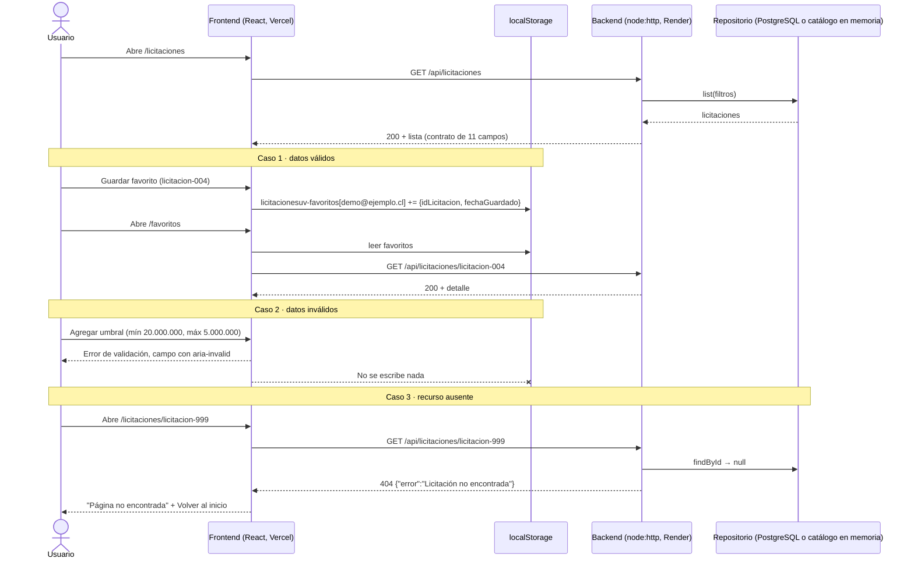

# Evidencia de integración — Hito 3 (#163)

Registro de los tres casos de integración que pide la guía del Hito 3 (criterio
"Integración"): **datos válidos**, **datos inválidos** y **recurso ausente**. Cada
caso se ejecutó de punta a punta sobre la versión desplegada y además está
cubierto por pruebas automáticas que corren en CI en cada PR.

| Dato                 | Valor                                                                                                                                 |
| -------------------- | ------------------------------------------------------------------------------------------------------------------------------------- |
| Ejecutado por        | Mauricio Henríquez (QA, @StelleC)                                                                                                     |
| Fecha                | 24-11-2026, 17:31–17:36 (hora de Chile, -03)                                                                                          |
| Frontend             | https://licitacionesuv.vercel.app (bundle `index-CGAoIa-e.js`)                                                                        |
| Backend              | https://licitacionesuv-backend.onrender.com/api (Render, plan gratuito)                                                               |
| Navegador            | Chrome 156.0.8078.100                                                                                                                 |
| Sesión               | Usuario de demostración `demo@ejemplo.cl` (autenticación simulada)                                                                    |
| Estado inicial/final | `localStorage` = `{"licitacionesuv-theme":"light","licitacionesuv-favoritos":"{}"}`, `sessionStorage` vacío. Se restauró al terminar. |

## Diagrama de integración

## Caso 1 — Datos válidos: guardar y ver un favorito

**Flujo:** catálogo desde la API → guardar favorito → persistencia en `localStorage` → vista `/favoritos` con el detalle desde la API.

| Paso | Acción                                                              | Resultado observado                                                                                                                                         |
| ---- | ------------------------------------------------------------------- | ----------------------------------------------------------------------------------------------------------------------------------------------------------- |
| 1    | Despertar el backend con `GET /api/health`                          | Primero `503 SERVICE WAKING UP` (arranque en frío de Render); luego `200 {"status":"ok"}`                                                                   |
| 2    | Abrir `/licitaciones`                                               | "6 de 6 convocatorias visibles", datos pedidos a `…onrender.com/api/licitaciones`                                                                           |
| 3    | Pulsar "Guardar favorito: Desarrollo de sistema de gestión interna" | Abre el diálogo de inicio de sesión (la acción exige sesión)                                                                                                |
| 4    | "Rellenar con datos de ejemplo" → "Iniciar sesión de prueba"        | Sesión `demo@ejemplo.cl` en `sessionStorage`                                                                                                                |
| 5    | Pulsar de nuevo "Guardar favorito"                                  | `licitacionesuv-favoritos` = `{"demo@ejemplo.cl":[{"idLicitacion":"licitacion-004","fechaGuardado":"2026-11-24T20:32:56.749Z"}]}`                           |
| 6    | Abrir `/favoritos`                                                  | "1 licitación guardada": Desarrollo de sistema de gestión interna · Banco Internacional · Biobío · $15.000.000 · cierra 20-dic-2026; contador del menú en 1 |

**Resultado:** ✅ Correcto.

**Pruebas automáticas que cubren el caso:**

- Frontend `tests/favoritosStorage.test.js`: "agrega un favorito con fechaGuardado y no duplica", "persiste y vuelve a leer el store completo", "quita un favorito sin afectar a otros usuarios".
- Frontend `tests/licitacionesApi.test.js`: "pide GET /licitaciones y devuelve la lista", "pide GET /licitaciones/:id con el id codificado".
- Backend `tests/licitaciones.test.js`: "lista todas las licitaciones del mock", "mantiene el contrato de datos del frontend", "responde con el detalle cuando el id existe".

## Caso 2 — Datos inválidos: umbral de aprobación mal formado

**Flujo:** formulario "Agregar umbral a una unidad" en `/configuracion/umbrales` → validación → persistencia (no debe ocurrir).

| Paso | Entrada                                                                                       | Resultado observado                                                                                                                                          |
| ---- | --------------------------------------------------------------------------------------------- | ------------------------------------------------------------------------------------------------------------------------------------------------------------ |
| 1    | Facultad de Ingeniería, Jefe de unidad, mínimo `20000000`, máximo `5000000` (rango invertido) | Mensaje "El monto máximo debe ser mayor que el mínimo (el máximo no se incluye)." y `aria-invalid="true"` en `#umbral-maximo`                                |
| 2    | Mínimo `1000,5`, máximo vacío (monto con decimales)                                           | Mensaje "Ingresa un monto mínimo en pesos enteros, igual o mayor que 0 (solo dígitos, sin puntos ni decimales)." y `aria-invalid="true"` en `#umbral-minimo` |
| 3    | Revisar persistencia tras ambos intentos                                                      | No se creó la clave `licitacionesuv-umbrales`; la tabla de Facultad de Ingeniería sigue con 3 umbrales                                                       |

**Resultado:** ✅ Correcto. Las entradas inválidas se rechazan con un mensaje accesible y no se escriben.

**Pruebas automáticas que cubren el caso:**

- Frontend `tests/umbralesStorage.test.js`: "#124: descarta un alta inválida o que se solapa con la configuración vigente", "tolera datos corruptos o con formato inesperado", "normaliza la configuración y descarta unidades y umbrales inválidos".
- Frontend `tests/umbralesUtils.test.js`: "rechaza montos negativos, no numéricos y rangos invertidos", "#125: rechaza montos fraccionarios y no representables con precisión", "rechaza decimales, separadores, signos y notación científica".
- Frontend `tests/persistenciaLocal.test.js`: "informa ilegible si lo guardado no es JSON", "devuelve false sin almacenamiento, si está bloqueado o sin cuota".
- Backend `tests/montos.test.js`: "rechaza montos negativos, decimales o que no son números"; `tests/licitaciones.test.js`: "ignora una región o un tipo inválido, igual que el explorador".

## Caso 3 — Recurso ausente: licitación que no existe

**Flujo:** detalle `/licitaciones/:id` con un id que no está en el repositorio.

| Paso | Acción                                                       | Resultado observado                                                                                                                     |
| ---- | ------------------------------------------------------------ | --------------------------------------------------------------------------------------------------------------------------------------- |
| 1    | `GET /api/licitaciones/no-existe` directo a la API           | `404 {"error":"Licitación no encontrada"}`                                                                                              |
| 2    | Abrir `/licitaciones/licitacion-999` (id con formato válido) | La SPA muestra "Página no encontrada. La dirección que buscas no existe o fue movida." con "Volver al inicio"                           |
| 3    | Abrir `/licitaciones/no-existe`                              | Mismo mensaje, sin errores ni pantalla en blanco                                                                                        |
| 4    | Backend dormido (observado en el paso 1 del caso 1)          | Render responde `503 SERVICE WAKING UP` durante el arranque en frío; la SPA queda en "Cargando licitaciones…" hasta que la API responde |

**Resultado:** ✅ Correcto para el 404. ⚠️ El arranque en frío de Render es una limitación del plan gratuito, no un error de la aplicación. Para la demostración hay que despertar el backend antes con `/api/health`.

**Pruebas automáticas que cubren el caso:**

- Frontend `tests/licitacionesApi.test.js`: "devuelve null si la API responde 404", "lanza ApiError con status 0 si la red falla", "lanza ApiError con el código si la API responde un error".
- Backend `tests/licitaciones.test.js`: "responde 404 cuando el id no existe", "rutas no registradas · responde 404 con mensaje de error".
- Backend `tests/cli.test.js`: "sirve el catálogo propio sin PostgreSQL desde otra carpeta" (base de datos ausente → catálogo en memoria).
- La regresión FLU-03 de QA #128 cubre la API caída desde el navegador (evidencia en `docs/evidencia/qa-regresion-128/`, rama `chore/128-qa-regresion-frontend`, pendiente de PR).

## Cobertura y CI

| Repositorio | Suite                                     | Resultado                                               | Cobertura (líneas / ramas / funciones) | Fuente                                                                   |
| ----------- | ----------------------------------------- | ------------------------------------------------------- | -------------------------------------- | ------------------------------------------------------------------------ |
| Frontend    | `npm run verify` (node:test, 47 suites)   | 230/230                                                 | 98,51 % / 92,25 % / 98,05 %            | `develop @ 1e8b921` (detalle en la rama de #135)                         |
| Backend     | `npm test` (node:test)                    | 69/70, 1 omitida (sin `DATABASE_URL_TEST`)              | 94,88 % / 88,61 % / 100 %              | QA #9 en el repo backend (`docs/evidencia/qa-contratos-postgresql-9.md`) |
| Backend CI  | GitHub Actions `verify` con PostgreSQL 16 | ✅ success (incluye la integración con PostgreSQL real) | —                                      | run 45101375723 sobre `develop @ cc2832b`                                |

Las pruebas de ambos repositorios corren en el workflow `verify` de GitHub Actions en cada PR hacia `develop`. Un PR no se puede fusionar si el workflow falla.

## Limitaciones

- Prueba manual sobre producción. Los pasos del caso 1 y del caso 2 dejan datos en `localStorage` del navegador, así que se restauró el estado inicial al terminar.
- La autenticación es simulada (usuario de demostración). El inicio de sesión con Google está en curso (#165 y backend #18).
- En local, el navegador integrado de la herramienta bloquea `localhost:5173 → localhost:3000`. Por eso los casos se ejecutaron sobre el despliegue Vercel → Render.
