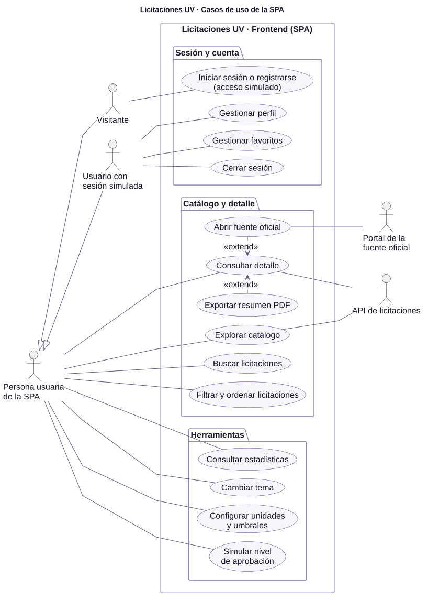
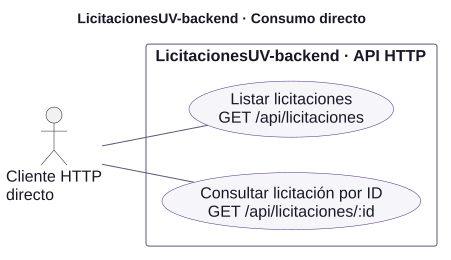

# 1 · Diagrama de casos de uso

[Índice de modelado](README.md) · [Fuente editable PlantUML](1-casos-de-uso.puml)

## Frontend

## Consumo directo de la API

## Nota de lectura

- La frontera del frontend encierra lo que una persona puede hacer desde la SPA. Visitante y Usuario con sesión simulada heredan los casos comunes de Persona usuaria de la SPA.
- Ambos roles pueden explorar, buscar por título, filtrar, ordenar, consultar el detalle y las estadísticas y cambiar de tema.
- El acceso permite iniciar sesión o registrarse en modo simulado. Con sesión se habilitan el perfil, los favoritos y el cierre de sesión.
- Configurar unidades y umbrales y simular el nivel de aprobación son acciones disponibles en `/configuracion/umbrales` para ambos roles.
- «Exportar resumen PDF» y «Abrir fuente oficial» son opciones del detalle. Por eso cada flecha `«extend»` va desde la opción hacia «Consultar detalle», que funciona por sí solo.
- La API colabora con la SPA en la carga del catálogo y del detalle. El portal oficial participa cuando la persona sigue el enlace de origen.
- El segundo diagrama muestra al cliente HTTP directo accediendo a la API sin pasar por la SPA y con la frontera del backend independiente.
- Se conservan los nombres «Buscar licitaciones» y «Exportar resumen PDF» para coordinar con la [secuencia de búsqueda](3-secuencia.md) y la [tarea de secuencia PDF](https://github.com/Wilson-Jara/LicitacionesUV/issues/131).

## Correspondencia con el código

| Caso de uso                                                          | Dónde se implementa y qué se verificó                                                                                                                                                                                                                                                                                        |
| -------------------------------------------------------------------- | ---------------------------------------------------------------------------------------------------------------------------------------------------------------------------------------------------------------------------------------------------------------------------------------------------------------------------- |
| Explorar catálogo, buscar licitaciones, filtrar y ordenar            | [Explorador](../../src/features/licitaciones/pages/LicitacionesExplorerPage.jsx), [proveedor](../../src/app/providers/LicitacionesProvider.jsx) y [filtros](../../src/features/licitaciones/licitacionFilters.js). El catálogo se carga por HTTP. La búsqueda por título, los filtros y el orden se aplican en el navegador. |
| Consultar detalle y abrir fuente oficial                             | [Detalle](../../src/features/licitaciones/pages/LicitacionDetailPage.jsx) y [cliente HTTP](../../src/features/licitaciones/services/licitacionesApi.js). El detalle consulta por ID y el enlace abre `sourceUrl` en otra pestaña.                                                                                            |
| Exportar resumen PDF                                                 | [Detalle](../../src/features/licitaciones/pages/LicitacionDetailPage.jsx) y [servicio de exportación](../../src/features/licitaciones/services/exportLicitacionPdf.js). El Web Worker genera el archivo y el detalle informa los fallos de exportación.                                                                      |
| Consultar estadísticas y cambiar tema                                | [Panel de estadísticas](../../src/features/estadisticas/pages/PanelEstadisticasPage.jsx) y [control de tema](../../src/shared/components/ThemeToggle.jsx).                                                                                                                                                                   |
| Iniciar sesión o registrarse, gestionar perfil y cerrar sesión       | [Formulario de acceso](../../src/features/auth/components/AuthForm.jsx), [proveedor de sesión](../../src/app/providers/AuthProvider.jsx) y [perfil](../../src/features/auth/pages/PerfilPage.jsx).                                                                                                                           |
| Gestionar favoritos                                                  | [Acción en catálogo y detalle](../../src/features/licitaciones/components/FavoritoButton.jsx) y [página de favoritos](../../src/features/favoritos/pages/MisFavoritosPage.jsx). Guardar o quitar requiere sesión. Las licitaciones cerradas pueden quitarse si ya están guardadas.                                           |
| Configurar unidades y umbrales y simular nivel de aprobación         | [Ruta de configuración](../../src/app/routes/AppRoutes.jsx) y [página de umbrales](../../src/features/aprobaciones/pages/ConfiguracionUmbralesPage.jsx). La ruta es pública y el simulador usa la configuración de la unidad elegida.                                                                                        |
| Listar licitaciones y consultar por ID desde un cliente HTTP directo | [Contrato de listado](../api/listado-licitaciones.md) y [contrato de detalle](../api/detalle-licitacion.md).                                                                                                                                                                                                                 |

Para regenerar ambos SVG desde la raíz con PlantUML y Graphviz, ejecuta `java -jar plantuml.jar -charset UTF-8 -tsvg -nometadata docs/modelado/1-casos-de-uso.puml`. [PlantUML por línea de comandos](https://plantuml.com/command-line)
