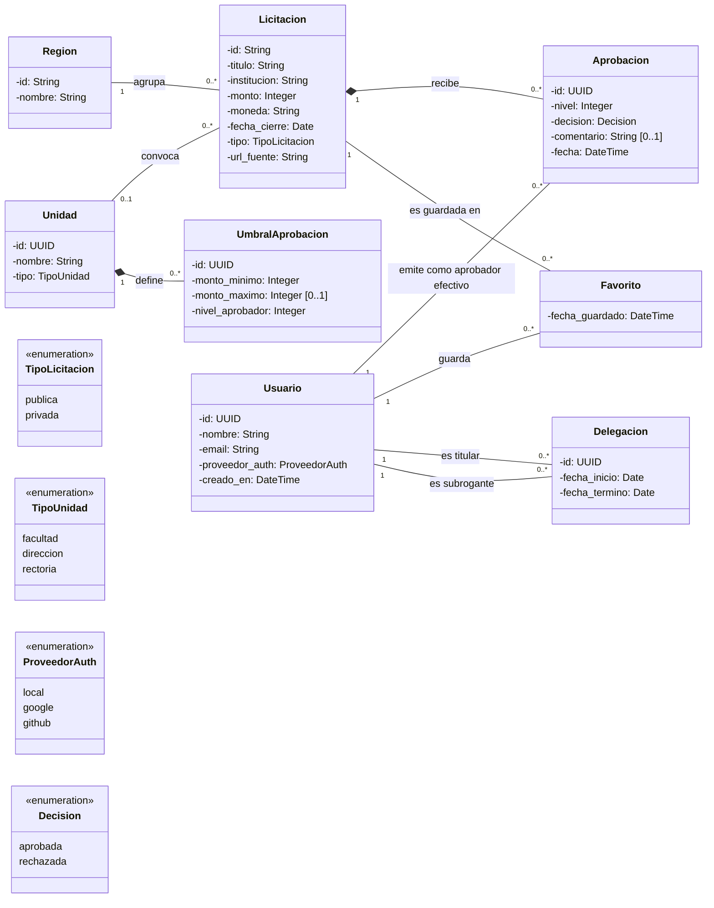

# 2 · Diagrama de clases

**Responsable:** Benjamin Lazo (@lazo1838k) · Backend / Integraciones

Modelo del dominio de LicitacionesUV. Las clases y atributos son las **ocho entidades** que define el esquema del backend independiente ([`LicitacionesUV-backend/migrations/postgresql/001_esquema_inicial.sql`](https://github.com/Wilson-Jara/LicitacionesUV-backend/blob/develop/migrations/postgresql/001_esquema_inicial.sql)), con los mismos nombres de columna. Cada clase corresponde a una tabla (`Licitacion` → `licitaciones`, `UmbralAprobacion` → `umbrales_aprobacion`, etc.).

## Nota de lectura

1. La decisión central es separar **qué depende de qué** según si una clase puede existir sola.
2. `Unidad ◆— UmbralAprobacion` es **composición**: un umbral solo tiene sentido dentro de su unidad (en la base, `ON DELETE CASCADE`).
3. `Licitacion ◆— Aprobacion` también es composición: una aprobación sin su licitación no significa nada.
4. `Region — Licitacion` es **asociación simple**: una región existe aunque no tenga licitaciones y no se borra con ellas.
5. `Unidad — Licitacion` es `0..1`: `unidad_id` admite nulo porque el catálogo actual no trae unidad.
6. `Favorito` es una **clase de asociación** entre `Usuario` y `Licitacion`, con su fecha de guardado; no es composición porque tiene **dos** dueños.
7. `Delegacion` conecta dos veces a `Usuario` (titular y subrogante) porque la regla R3 del CR-302 compara ambos roles por fecha.
8. **Estado actual:** favoritos y umbrales se guardan en el `localStorage` del navegador; sus tablas existen en PostgreSQL, pero todavía no tienen un flujo activo por la API.

## Correspondencia con el código

| Clase                        | Tabla (backend)                   | Uso en el código                                                                                                                                                                |
| ---------------------------- | --------------------------------- | ------------------------------------------------------------------------------------------------------------------------------------------------------------------------------- |
| `Licitacion`                 | `licitaciones`                    | `licitaciones.repository.js` la lee; `mapLicitacionRow` la entrega al frontend con el contrato REF-10 (`titulo` → `title`, `monto` → `amount`, `fecha_cierre` → `closingDate`…) |
| `Region`                     | `regiones`                        | Catálogo cargado por `002_catalogo_regiones.sql`; el frontend usa las mismas claves (`valparaiso`, `metropolitana`…)                                                            |
| `Favorito`                   | `favoritos`                       | Hoy el frontend lo persiste en `localStorage` (`favoritosStorage.js`: `idLicitacion` + `fechaGuardado`) con la misma estructura                                                 |
| `Unidad`, `UmbralAprobacion` | `unidades`, `umbrales_aprobacion` | Panel de configuración de umbrales (`features/aprobaciones`), persistido en `localStorage`                                                                                      |
| `Usuario`                    | `usuarios`                        | `AuthProvider` (sesión simulada en el cliente)                                                                                                                                  |
| `Aprobacion`, `Delegacion`   | `aprobaciones`, `delegaciones`    | Tablas creadas sin endpoints; su lógica corresponde a US-09 y US-11                                                                                                             |

## Lo que descubrimos al modelarlo

- **Los nombres cambian de capa:** la base usa `snake_case` en español (`fecha_cierre`) y el contrato de la API usa inglés en `camelCase` (`closingDate`). La traducción ocurre en un solo lugar, `mapLicitacionRow`, para que el frontend no dependa de la base.
- **El nivel aprobador no coincide entre capas:** en la base es un número (`nivel_aprobador SMALLINT`) y en el frontend un texto (`'jefe_unidad'`, `'direccion_economica'`, `'rectoria'`). Hay que unificarlo cuando el panel de umbrales pase a guardar en la API.
- **Los montos se guardan como enteros** (`BIGINT`) para no perder precisión con decimales en pesos chilenos; `pg` los entrega como texto y el repositorio los convierte a número.
