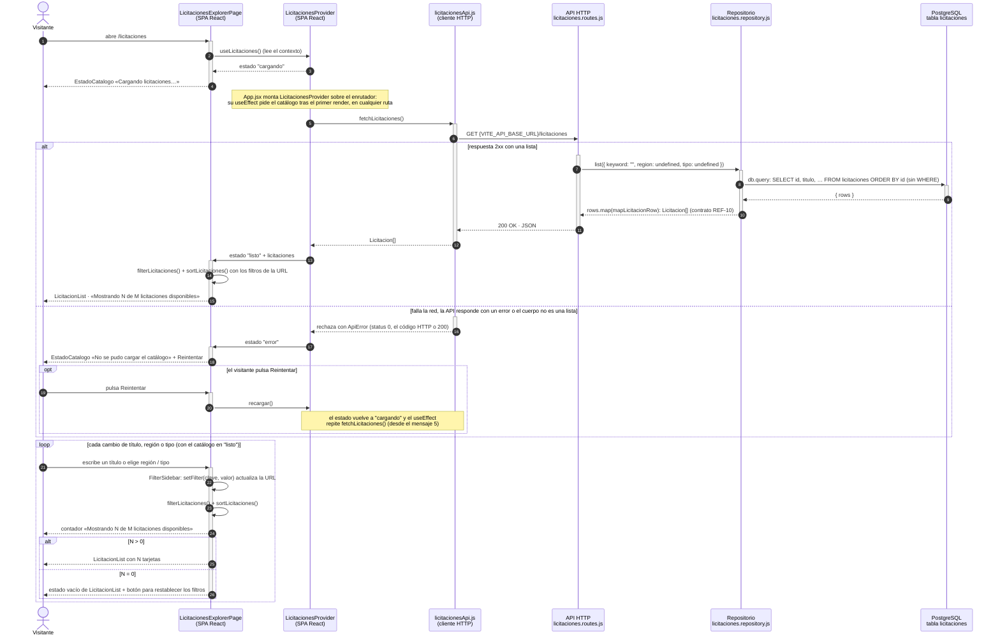

# 3 · Diagrama de secuencia: Buscar licitaciones

Caso de uso **«Buscar licitaciones»** (HU #43) del diagrama de casos de uso. Actor: **Visitante**. Describe el flujo implementado con la SPA conectada a la API (PR #151): la SPA pide el catálogo una vez a `LicitacionesUV-backend` y filtra en el navegador.

## Nota de lectura

Elegimos «Buscar licitaciones» porque recorre todas las capas del sistema: pantalla, estado compartido, cliente HTTP, API, repositorio y base de datos. La decisión que muestra el diagrama es **pedir el catálogo una sola vez y filtrar en el navegador** (mensajes 5 a 15, frente a los del `loop`). Así la búsqueda responde mientras se escribe sin esperar a la red (REF-01) y no se hace una petición por cada tecla; con un catálogo de decenas o cientos de licitaciones, traerlo completo una vez es razonable. Por eso el `loop` no cruza la red: buscar no vuelve a llamar a la API. El primer `alt` separa un **error de carga** (red caída, respuesta de error o formato inesperado, con un reintento opcional) de una **búsqueda sin resultados** (el `alt` del `loop`), que no es un error: el contador queda en 0 y la lista vacía. El costo de la decisión es que la regla «buscar solo en el título» existe en dos lugares: `filterLicitaciones` en la SPA y `matchesKeyword`/`ILIKE` en la API, que sigue aceptando `?keyword=` para otros clientes.

## Correspondencia con el código

| Línea de vida                           | Archivo real                                                                                     | Responsabilidad en el caso                                                                                                                                                   |
| --------------------------------------- | ------------------------------------------------------------------------------------------------ | ---------------------------------------------------------------------------------------------------------------------------------------------------------------------------- |
| Visitante                               | Actor del diagrama de casos de uso                                                               | Inicia la búsqueda                                                                                                                                                           |
| `LicitacionesExplorerPage`              | `src/features/licitaciones/pages/LicitacionesExplorerPage.jsx`                                   | Lee el catálogo con `useLicitaciones`, muestra `EstadoCatalogo` mientras carga o si falla, filtra con `licitacionFilters.js` y pinta `LicitacionList` solo en estado `listo` |
| `FilterSidebar` (dentro del explorador) | `src/features/licitaciones/components/FilterSidebar.jsx`                                         | `setFilter(clave, valor)` de `useLicitacionFilters` actualiza una clave de la URL y la quita si queda vacía                                                                  |
| `LicitacionesProvider`                  | `src/app/providers/LicitacionesProvider.jsx` (montado en `src/app/App.jsx`)                      | Pide el catálogo tras el primer render, guarda `cargando` / `listo` / `error` y ofrece `recargar()`                                                                          |
| `licitacionesApi.js`                    | `src/features/licitaciones/services/licitacionesApi.js`                                          | `fetchLicitaciones()`: `GET` a `VITE_API_BASE_URL` (o `http://localhost:3000/api` si no está definida) + `/licitaciones`; traduce fallas a `ApiError`                        |
| API HTTP                                | `LicitacionesUV-backend/src/routes/licitaciones.routes.js` (compuesta en `src/app.js`, con CORS) | Recorta `keyword`, llama a `repository.list()` y responde `200` con JSON                                                                                                     |
| Repositorio                             | `LicitacionesUV-backend/src/data/licitaciones.repository.js`                                     | `createPgLicitacionesRepository`: `buildListQuery` arma el SQL parametrizado y `mapLicitacionRow` traduce cada fila al contrato REF-10                                       |
| PostgreSQL                              | `LicitacionesUV-backend/migrations/postgresql/` (`pg.Pool` en `src/db/pool.js`)                  | Tabla `licitaciones`                                                                                                                                                         |

Sin `DATABASE_URL`, `src/server.js` no crea el repositorio PostgreSQL y `createApp()` usa el repositorio en memoria (`createMemoryLicitacionesRepository`), que responde el mismo `list()` sin consultar una base: la secuencia es igual hasta el repositorio.

## Coherencia con los otros diagramas

- **Casos de uso:** el caso se llama igual, «Buscar licitaciones», y el actor es el mismo Visitante.
- **Clases:** lo que viaja es `Licitacion` (tabla `licitaciones`), la misma clase del diagrama de clases; `mapLicitacionRow` es el punto donde los nombres de la base (`fecha_cierre`) pasan al contrato de la API (`closingDate`).
- **Componentes:** las líneas de vida corresponden a «SPA React», «API HTTP», «Contrato de repositorio» y «PostgreSQL». La flecha `GET /licitaciones` es la interfaz que la SPA requiere y la API provee.

## Qué descubrimos al modelarlo

- **Buscar no llama a la API.** Al dibujar el `loop` quedó claro que escribir en el buscador no genera peticiones: el filtrado ocurre sobre el catálogo ya cargado. En la pestaña Network solo aparecen la carga del catálogo (y sus reintentos) y la del detalle.
- **La regla «solo título» está duplicada.** Vive en `filterLicitaciones` (SPA) y en `matchesKeyword`/`ILIKE` (API). Ya falló dos veces por eso: el frontend se corrigió en el commit `9b41879` (PR #71) y la API en el commit `01e02d0` (PR #88), como registra `docs/depuracion.md`. Si cambia la regla, hay que cambiar ambos lados.
- **Vacío no es error.** Una búsqueda sin resultados deja el contador en 0 y la lista vacía; el error solo aparece si falla la carga del catálogo. Por eso son dos `alt` distintos, con mensajes distintos.
