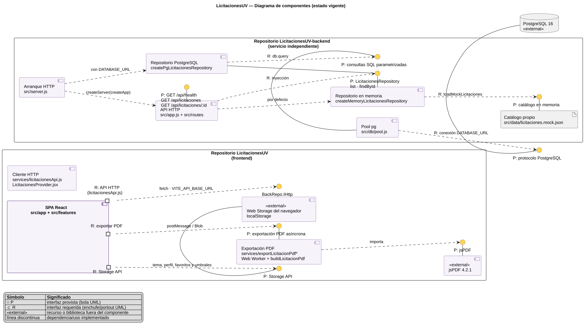

# ISF225 — Diagrama de componentes

Este modelo representa el estado implementado de los repositorios
[`LicitacionesUV`](https://github.com/Wilson-Jara/LicitacionesUV) y
[`LicitacionesUV-backend`](https://github.com/Wilson-Jara/LicitacionesUV-backend).
La fuente editable está en [`4-componentes.puml`](4-componentes.puml). Se usa
PlantUML con notación UML 2: las interfaces provistas se muestran como bolas
(`P`) y las requeridas como enchufes `portout` (`R`).

> Para renderizar localmente: `plantuml docs/modelado/4-componentes.puml`. El
> archivo no necesita datos privados ni variables de entorno.

## Nota explicativa (8 líneas)

1. La SPA React carga el catálogo mediante `LicitacionesProvider` y `licitacionesApi.js`, usando la API independiente.
2. Tema, perfil, favoritos y umbrales requieren la Web Storage API y persisten bajo claves propias en `localStorage`.
3. La exportación PDF se ejecuta en un Web Worker y requiere la biblioteca externa jsPDF.
4. El backend provee salud, listado y detalle mediante una interfaz HTTP de solo lectura.
5. `src/server.js` inyecta el adaptador PostgreSQL cuando existe `DATABASE_URL`; si no, `createApp` usa el adaptador en memoria.
6. Sin `DATABASE_URL`, el adaptador en memoria carga el catálogo propio del backend.
7. Con `DATABASE_URL`, el adaptador PostgreSQL consulta mediante `pg.Pool` y SQL parametrizado.
8. #113 separó los repositorios y #151 ensambló la interfaz HTTP que conecta la SPA con la API.

## Trazabilidad de componentes e interfaces

| Elemento del diagrama      | Ruta implementada                                                                                                                                                                                                                | Interfaz o responsabilidad comprobada                                                                  |
| -------------------------- | -------------------------------------------------------------------------------------------------------------------------------------------------------------------------------------------------------------------------------- | ------------------------------------------------------------------------------------------------------ |
| SPA React                  | `src/app/`, `src/features/`                                                                                                                                                                                                      | Compone rutas, features, filtros, favoritos y umbrales.                                                |
| Cliente HTTP               | `src/features/licitaciones/services/licitacionesApi.js`, `src/app/providers/LicitacionesProvider.jsx`                                                                                                                            | Requiere `VITE_API_BASE_URL` y provee listado/detalle mediante `fetch`.                                |
| Persistencia del navegador | `src/app/providers/ThemeProvider.jsx`, `src/features/auth/data/profileStorage.js`, `src/features/favoritos/data/favoritosStorage.js`, `src/features/aprobaciones/data/umbralesStorage.js`, `src/shared/lib/persistenciaLocal.js` | Requiere `Storage.getItem/setItem`; centraliza lectura/escritura compartida para favoritos y umbrales. |
| Exportación PDF            | `src/features/licitaciones/services/exportLicitacionPdf.js`, `exportLicitacionPdfCore.js`, `exportLicitacionPdf.worker.js`, `buildLicitacionPdf.js`                                                                              | Mensajes con el worker, `ArrayBuffer`, `Blob` y descarga; jsPDF genera el documento.                   |
| Arranque del backend       | `LicitacionesUV-backend/src/server.js`, `src/app.js`                                                                                                                                                                             | `server.js` inyecta PostgreSQL si corresponde; `createApp` usa memoria por defecto.                    |
| API HTTP                   | `LicitacionesUV-backend/src/app.js`, `src/routes/health.routes.js`, `src/routes/licitaciones.routes.js`                                                                                                                          | Provee `GET /api/health`, `GET /api/licitaciones` y `GET /api/licitaciones/:id`.                       |
| Contrato de repositorio    | `LicitacionesUV-backend/src/data/licitaciones.repository.js`                                                                                                                                                                     | Ambos adaptadores proveen `list(filters)` y `findById(id)`.                                            |
| Catálogo en memoria        | `LicitacionesUV-backend/src/data/mockLicitaciones.js`, `src/data/licitaciones.mock.json`                                                                                                                                         | Se carga únicamente cuando no se configura PostgreSQL.                                                 |
| PostgreSQL                 | `LicitacionesUV-backend/src/db/pool.js`, `migrations/postgresql/`                                                                                                                                                                | `pg.Pool` requiere `DATABASE_URL`; el repositorio usa consultas parametrizadas.                        |

## Comprobación de conexiones

- `LicitacionesProvider` usa `fetchLicitaciones` y `fetchLicitacion` de
  `licitacionesApi.js`; el explorador, detalle, favoritos y estadísticas reciben
  el catálogo desde el proveedor.
- `ThemeProvider` y `profileStorage` usan `window.localStorage` directamente;
  favoritos y umbrales pasan por `src/shared/lib/persistenciaLocal.js`.
- `exportLicitacionPdf.js` crea el worker; el núcleo envía `postMessage`, recibe
  el búfer y crea el `Blob`; el worker delega la composición a jsPDF.
- En el backend, `server.js` crea el adaptador PostgreSQL solo con
  `DATABASE_URL`; en caso contrario `createApp` construye el adaptador en memoria.
- `registerLicitacionesRoutes` depende solo de la interfaz del repositorio, por
  lo que ambas implementaciones son intercambiables.
- El `pg.Pool` es el único componente que importa `pg` y abre la conexión con
  PostgreSQL; el catálogo JSON del backend no depende del frontend.
- El enchufe `R: API HTTP (licitacionesApi.js)` se conecta a la interfaz `IHttp`;
  `VITE_API_BASE_URL` permite cambiar el origen sin modificar el proveedor.

## Evidencia de separación

La tarea [#113](https://github.com/Wilson-Jara/LicitacionesUV/issues/113) y su
evidencia de cierre confirman la separación de repositorios. La integración
posterior de #151 implementa el cliente HTTP y `LicitacionesProvider`, por lo que
el diagrama conecta ahora la SPA con la interfaz provista por la API, sin afirmar
que el frontend lea directamente el catálogo JSON del backend.
