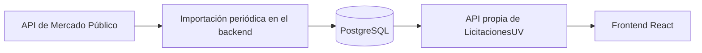

# Separación del backend: estado, alcance y verificación

Fecha de revisión: 8 de noviembre de 2026.

Referencia: [tarea de separación del backend](https://github.com/Wilson-Jara/LicitacionesUV/issues/113).

Este documento conserva la situación previa y registra la separación ejecutada
localmente. `backend/` se retiró del principal después de comprobar
el backend independiente con PostgreSQL real y desde una instalación aislada.
La tarea no está cerrada: la publicación, los PR, el CI remoto y la revisión humana
requieren sus propias comprobaciones y autorizaciones.

## 1. Objetivo y alcance

El objetivo de la tarea es mantener `LicitacionesUV` como frontend y operar la API
desde `LicitacionesUV-backend`, sin dependencia de archivos del cliente y conservando
los contratos existentes. El texto actual de la tarea incluye PostgreSQL.
La infraestructura confirmada usa instalación nativa de PostgreSQL en desarrollo
y CI; se descarta la orquestación mediante contenedores.

El alcance ejecutado incluye el backend PostgreSQL independiente, sus pruebas,
la retirada de la copia del principal y la actualización de configuración
y documentación. No se leen, trasladan ni convierten bases de desarrollo. La conexión
del frontend con la API, Mercado Público, nuevas funcionalidades y producción son
trabajos separados.

La futura integración con Mercado Público se considera aquí para fundamentar la
elección del motor; no se presenta como funcionalidad implementada.

## 2. Estado previo a la ejecución

La tabla siguiente es una captura anterior al cambio: sus diferencias SQLite y
PostgreSQL no describen la versión local final. Las rutas parten de la raíz de
cada proyecto. No se verificaron ramas ni historial Git. Se confirmó mediante
consulta de metadatos que `Wilson-Jara/LicitacionesUV-backend` existe y es público;
no se cambiaron sus permisos ni se publicó esta implementación.

| Aspecto                    | Principal: `LicitacionesUV`                                          | Separado: `LicitacionesUV-backend`                                     |
| -------------------------- | -------------------------------------------------------------------- | ---------------------------------------------------------------------- |
| Frontend                   | React y Vite; consume su mock local                                  | No contiene el frontend                                                |
| API                        | Existe dentro de `backend/`                                          | Existe en `src/`                                                       |
| Persistencia               | PostgreSQL con `pg`; sin conexión configurada usa el mock en memoria | SQLite con `node:sqlite`; el servidor usa siempre SQLite               |
| Catálogo de ejemplo        | `src/features/licitaciones/data/licitaciones.mock.json`              | `src/data/licitaciones.mock.json` propio                               |
| Dependencia entre carpetas | `backend/src/data/mockLicitaciones.js` lee el catálogo del frontend  | El cargador apunta al catálogo del propio backend                      |
| Migraciones                | `backend/migrations/` para PostgreSQL                                | `migrations/sqlite/` activa; `migrations/legacy-postgresql/` histórica |
| Arranque                   | No aplica migraciones automáticamente                                | Aplica migraciones al arrancar; no ejecuta el seed                     |
| Base nueva                 | Requiere migraciones y seed al usar PostgreSQL                       | Queda vacía hasta ejecutar el seed                                     |
| Node declarado             | Desde 20.19.0                                                        | Desde 22.22.0                                                          |
| CI definido                | Comprueba frontend y backend; levanta PostgreSQL de prueba           | Comprueba backend con integración SQLite temporal                      |

Ambos catálogos contienen los mismos seis registros de ejemplo, comparados como
JSON. Esto acredita la copia del catálogo, no la conservación de datos que pudieran
existir en una base de desarrollo.

Las dos migraciones históricas de PostgreSQL del proyecto separado coinciden con
las del principal al normalizar los saltos de línea. También coinciden los helpers
HTTP, el router, la ruta de salud y las pruebas de salud, HTTP y licitaciones.
La capa de datos, el arranque, los scripts y varias pruebas tienen diferencias de
contenido. El pool PostgreSQL y el script de inicialización de su base de pruebas
no tienen equivalente directo en la raíz actual del backend separado.

**Conclusión:** el proyecto separado ya contiene una adaptación a SQLite; no es
una copia idéntica del backend PostgreSQL del principal. Sus migraciones históricas
no hacen que el servidor actual pueda ejecutar PostgreSQL.

## 3. Decisión sobre PostgreSQL y SQLite

**Decisión confirmada por el usuario el 8 de noviembre de 2026: PostgreSQL para
el backend independiente.** La importación de Mercado Público sigue siendo futura.

La API externa se puede consumir con cualquiera de los dos motores. La elección
depende de la operación del portal y de sus escrituras simultáneas, no del formato
de respuesta de Mercado Público.

| Criterio                                   | SQLite                                             | PostgreSQL                                               |
| ------------------------------------------ | -------------------------------------------------- | -------------------------------------------------------- |
| Instalación y operación inicial            | Archivo local; pocas piezas que administrar        | Servicio de base de datos que configurar y mantener      |
| Prototipo en un solo servidor              | Adecuado, incluida una API web con carga moderada  | Viable, con mayor preparación inicial                    |
| Escrituras simultáneas                     | Una escritura a la vez por archivo                 | Ofrece concurrencia de transacciones y bloqueos por fila |
| Varios procesos o servidores de aplicación | Requiere diseñar el acceso al archivo local        | Base central accesible por conexiones del backend        |
| Coincidencia con la tarea actual           | Requiere acordar y documentar el cambio de alcance | Coincide con el motor solicitado en la tarea             |

SQLite admite aplicaciones web y muchos lectores; no debe descartarse únicamente
por tener usuarios conectados. Su documentación recomienda evaluar un motor
cliente/servidor cuando se requieren muchas escrituras concurrentes o varios
servidores. PostgreSQL dispone de control de concurrencia mediante MVCC y bloqueos
de fila. [Guía de SQLite](https://www.sqlite.org/whentouse.html),
[concurrencia en PostgreSQL](https://www.postgresql.org/docs/16/mvcc-intro.html).

La recomendación presupone que las importaciones compartirán persistencia con
favoritos, configuración y otras acciones de usuarios. Es una decisión de diseño
propuesta; no existe una medición de carga que demuestre que SQLite sea insuficiente
para la versión actual.

El backend separado se adaptó a PostgreSQL mediante `pg` 8.23.1 y conserva el
catálogo propio en memoria cuando no se configura conexión, como hacía el original.
La línea activa es `migrations/postgresql/`; las líneas SQLite e histórica permanecen
sin alterar. No se convirtió ninguna base existente ni se implementó un importador.

## 4. Dependencias consideradas al retirar la carpeta

| Archivo o conjunto                                                                                   | Dependencia actual                                                                               | Tratamiento al ejecutar la separación                                                                                       |
| ---------------------------------------------------------------------------------------------------- | ------------------------------------------------------------------------------------------------ | --------------------------------------------------------------------------------------------------------------------------- |
| `.github/workflows/verify.yml`                                                                       | Instala `backend`, incluye su lockfile en la caché y prepara PostgreSQL de prueba                | Dejar en el principal las comprobaciones del frontend; el backend debe validar su propia instalación e integración          |
| `package.json`                                                                                       | La cobertura incluye `backend/src/**/*.js`; `node --test` descubre las pruebas de ambas carpetas | Retirar el patrón de cobertura del backend y volver a medir; no mantener porcentajes combinados como si fueran del frontend |
| `eslint.config.js`                                                                                   | Declara entorno Node para `backend/**/*.js`                                                      | Retirar el bloque que quede sin archivos; conservar la configuración del cliente                                            |
| `README.md`                                                                                          | Describe instalación y operación del proyecto                                                    | Explicar la separación y enlazar la documentación de ejecución de ambos proyectos                                           |
| `docs/AI_context.md`                                                                                 | Describe backend, comandos, pruebas y PostgreSQL dentro del principal                            | Actualizar al estado final real, sin afirmar la retirada antes de ejecutarla                                                |
| `docs/Arquitectura.md`                                                                               | Diagramas, módulo backend y decisiones con rutas internas                                        | Actualizar límites, rutas y motor confirmado; distinguir decisiones históricas de la arquitectura vigente                   |
| `docs/cobertura.md`                                                                                  | Métricas y alcance de medición combinados                                                        | Recalcular y documentar la cobertura correspondiente a cada proyecto                                                        |
| `docs/api/` y `docs/thunder-client/`                                                                 | Contratos y colecciones de la API                                                                | Mantener una ubicación de referencia clara y enlaces válidos, conservando la evidencia académica necesaria                  |
| `docs/ejercicio-2-2.md`, `docs/depuracion.md`, `docs/guia-vicente-garcia-depuracion.md` y evidencias | Ejemplos y resultados con rutas `backend/...`                                                    | Identificar su contexto histórico o actualizar instrucciones reproducibles sin alterar resultados históricos                |
| `.github/CODEOWNERS`                                                                                 | No contiene una regla específica `/backend/`                                                     | No exige un cambio por esa ruta; cualquier cambio de revisores se trata por separado                                        |

La configuración pública de ejemplo también requerirá revisión humana según el
motor elegido. No se han leído ni trasladado archivos `.env` reales ni bases locales.
Las decisiones sobre secretos, permisos, revisores y producción siguen las reglas
de [AGENTS.md](../AGENTS.md).

El frontend importa el mock local, no módulos de `backend/`. Retirar el backend no
conecta el cliente con la API ni habilita por sí mismo `VITE_API_BASE_URL`.

## 5. Contratos y recursos que deben conservarse

- `GET /api/health`: estado del servicio y estructura de respuesta actual.
- `GET /api/licitaciones`: listado y filtros `keyword`, `region` y `tipo`.
- `GET /api/licitaciones/:id`: detalle por identificador y errores documentados.
- Contrato de nueve campos: `id`, `title`, `amount`, `currency`, `institution`,
  `closingDate`, `type`, `region` y `sourceUrl`.
- Búsqueda literal solo en el título, sin distinguir mayúsculas y recortando espacios
  externos en la ruta HTTP; filtros combinados mediante Y lógico.
- Pruebas de errores HTTP, parámetros mal codificados e invariante del identificador.
- Esquema de las ocho entidades y catálogo de regiones, con las adaptaciones del
  motor que se apruebe. Trasladar las tablas no implementa endpoints de escritura,
  sesiones ni el flujo de aprobaciones.
- Catálogo ficticio propio y scripts de migración y seed independientes del frontend.
- Documentación de instalación, pruebas y operación desde la raíz del backend.

La instalación independiente debe probarse en una carpeta aislada que no tenga
acceso al checkout del frontend. La mera presencia de archivos en la carpeta vecina
no prueba que una clonación independiente funcione.

## 6. Procedimiento de separación y recuperación

Se completaron localmente la adaptación PostgreSQL, su instalación aislada y la
retirada coordinada del principal. El procedimiento sigue como referencia para
revisión y recuperación. La publicación y el cierre remoto no se han ejecutado.

1. Resolver la diferencia de motor y confirmar repositorio de destino, responsable,
   propietario, visibilidad y tratamiento del historial. No se dan por resueltos a
   partir del nombre de una carpeta local.
2. Conservar una copia recuperable del backend original y de sus archivos públicos.
   Si hay datos persistidos que deban conservarse, una persona debe definir su
   respaldo y tratamiento antes del cambio de motor o de infraestructura.
3. Completar en el backend separado la implementación correspondiente al motor
   confirmado, el catálogo propio y las comprobaciones de contratos e integración.
4. Verificarlo desde una instalación aislada y registrar los resultados locales y
   los del CI. Hasta entonces, el backend del principal sigue siendo necesario como
   referencia recuperable.
5. En un mismo cambio coherente del principal, retirar `backend/` y ajustar CI,
   cobertura y ESLint.
6. Actualizar la documentación de ambos proyectos y conservar identificada la
   evidencia histórica. No mezclar esta retirada con correcciones funcionales del
   frontend o con la integración de Mercado Público.
7. Ejecutar las comprobaciones de aceptación y revisar todos los cambios antes de
   cualquier publicación. Git, GitHub y cada efecto externo requieren la
   confirmación específica establecida en `AGENTS.md`.

Para volver atrás si falla una comprobación, restaurar conjuntamente la carpeta y
las configuraciones asociadas desde la copia conservada. Retirar archivos fuente
no requiere destruir una base, un contenedor ni un volumen. No se incluyen comandos
de borrado o de publicación en este procedimiento.

## 7. Verificación y evidencia de cierre

| Criterio                    | Evidencia requerida                                                                 | Situación al documentar                                                                                |
| --------------------------- | ----------------------------------------------------------------------------------- | ------------------------------------------------------------------------------------------------------ |
| Backend independiente       | Instalación aislada, catálogo propio y ejecución sin frontend                       | Instalación reproducible en carpeta temporal aislada y 43 pruebas aprobadas, sin archivos del frontend |
| Contratos conservados       | Suite HTTP, listado filtrado, detalle y errores                                     | 43 pruebas aprobadas con PostgreSQL 16.15 real, incluida la suite HTTP y el servidor                   |
| Persistencia e integración  | Migraciones, seed idempotente e integración con base de prueba del motor confirmado | PostgreSQL confirmado; migraciones y seed repetido comprobados con esquemas temporales aislados        |
| Frontend independiente      | `npm run verify`, cobertura general y crítica después de retirar `backend/`         | Carpeta retirada; verify completo pasa, con 121 pruebas, build y ambas coberturas correctos            |
| CI de ambos proyectos       | Ejecuciones remotas correctas y sus enlaces                                         | Se inspeccionaron definiciones locales; no se comprobaron ejecuciones remotas                          |
| Documentación reproducible  | Instrucciones probadas desde cada raíz y enlaces válidos                            | README, arquitectura, contexto y guías actualizados en ambos proyectos; instalación aislada comprobada |
| Conservación de información | Copia recuperable y decisión sobre datos e historial                                | Copia recuperable de fuentes públicas conservada; no se inspeccionaron bases privadas ni historial Git |
| Cierre de la tarea          | Enlaces a repositorios, PR, CI y revisión humana según la DoD                       | Implementación local preparada; faltan publicación, CI remoto y revisión humana                        |

Comprobaciones previstas en el frontend después de la retirada:

```text
npm run verify
npm run test:coverage
npm run test:coverage:critico
```

En el backend, usar los comandos de su README vigente después de confirmar el
motor: instalación reproducible, migraciones, seed, `npm run verify` y cobertura.
Las pruebas PostgreSQL deben usar una base desechable y explícitamente identificada;
las pruebas actuales del backend embebido borran y recrean su esquema de prueba.
No ejecutar migraciones ni seed contra una base con datos que deban conservarse
como parte de una simple verificación documental.

La revisión anterior al cambio obtuvo lint y formato correctos, 155 pruebas sin
integración PostgreSQL y compilación en memoria. Después de adaptar el backend,
pasaron 43 pruebas sin omisiones con PostgreSQL 16.15 temporal en loopback, también
en una instalación aislada. Su cobertura fue 96,22 % líneas, 93,69 % ramas y 100 %
funciones. No se usaron bases de desarrollo. En el cliente, verify completo pasa
con 121 pruebas y build; la cobertura fue 99,13 % líneas, 90,67 % ramas y 99,06 %
funciones. La cobertura crítica fue 100 % en las tres métricas. El CI remoto no se
ejecutó aquí. La infraestructura usa instalación nativa de PostgreSQL: se retiraron
los archivos de contenedores, su inicializador y las variables exclusivas del
orquestador. CI prepara PostgreSQL directamente en Ubuntu 24.04. Las bases locales
se crean manualmente según la guía del backend.

## 8. Preparación para Mercado Público

Esta sección es una propuesta para una entrega posterior. La separación de
repositorios conserva sus criterios actuales y no implementa la integración.

ChileCompra documenta consultas de licitaciones por fecha, estado y código. El
listado entrega datos básicos; la consulta por código entrega detalle. El acceso
requiere ticket y tiene un límite publicado de 10.000 solicitudes diarias por
ticket, consultado el 8 de noviembre de 2026. [Documentación oficial de la API](https://www.chilecompra.cl/api/).

Flujo recomendado:



Esta arquitectura permitiría reutilizar resultados y desacoplar las consultas de
usuarios de las llamadas al servicio externo. Habría que definir y comprobar:

- Ticket gestionado en el backend, sin incorporarlo al código del cliente, a URLs
  de navegación ni a registros compartidos. La obtención y configuración reales
  corresponden a una persona autorizada.
- Actualización por código de origen sin duplicar licitaciones, con fecha de última
  sincronización y tratamiento explícito de fallos, límites y reintentos.
- Un adaptador entre la respuesta oficial y el contrato propio. No asumir que
  listado y detalle traigan los mismos campos ni inventar montos desconocidos.
- Tratamiento de moneda, zona horaria, hora de cierre, estados y tipos externos;
  conservar la información necesaria antes de reducirla al formato del mock.
- Separación de datos ficticios y reales; pruebas con respuestas ficticias, sin
  depender de la API en vivo en cada ejecución del CI.

La fuente prevista son compras públicas. Las descripciones actuales del producto
que hablan exclusivamente de licitaciones de empresas privadas deberán revisarse
cuando se acuerde el alcance de esa integración.

## 9. Hallazgos previos del frontend

Estos defectos ya se identificaron antes de separar repositorios. Se conservan
como referencia para no atribuirlos al futuro cambio. No se corrigieron aquí.

| Hallazgo                                                 | Ubicación                                                                 | Evidencia o reproducción                                                                                                                                            |
| -------------------------------------------------------- | ------------------------------------------------------------------------- | ------------------------------------------------------------------------------------------------------------------------------------------------------------------- |
| Región y bases oficiales se superponen en el PDF         | `src/features/licitaciones/services/buildLicitacionPdf.js`                | Las dos filas usan la misma coordenada vertical; confirmado en el PDF en memoria                                                                                    |
| Guardado aparente de un umbral para una unidad eliminada | `src/features/aprobaciones/components/UmbralForm.jsx`                     | El estado conserva el id inicial y el almacenamiento descarta la operación; el padre muestra éxito. Identificado por inspección y comprobación de la operación pura |
| Estadísticas pierde los filtros al navegar               | `src/shared/components/Navbar.jsx`                                        | El enlace a `/estadisticas` omite el query string que consume el panel                                                                                              |
| Un correo inválido puede romper favoritos                | `src/features/favoritos/data/favoritosStorage.js` y formularios de acceso | `constructor` o `__proto__` superan la validación de texto no vacío y recuperan propiedades heredadas; la llamada a `some` falla                                    |
| Se aceptan rangos decimales con representación invertida | `src/features/aprobaciones/umbralesUtils.js`                              | Mínimo 0 y máximo 0.5 se validan, pero se muestran como `$0 – $-1`                                                                                                  |
| Modal sin gestión de foco ni cierre con Escape           | `src/features/auth/components/AuthModal.jsx`                              | Inspección: no hay enfoque inicial, retención/restauración del foco, manejador Escape ni nombre accesible del diálogo                                               |

No se realizó una prueba de interfaz en navegador durante esta revisión. Las
pruebas aprobadas no acreditan la ausencia de estos defectos.
